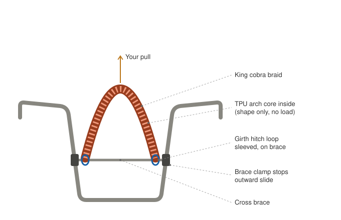
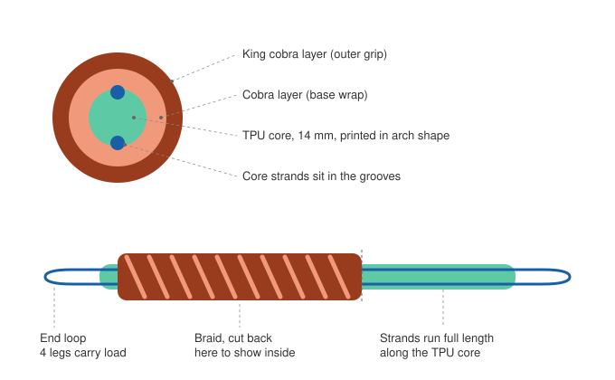
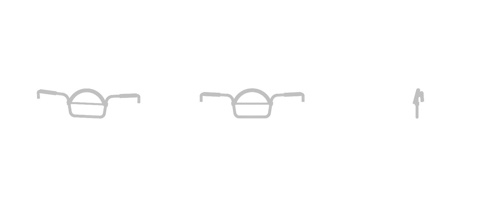

# Sled grab bar: paracord handle project

We are making a new grab handle for Dad's snowmobile, a 2017 Polaris RMK Pro 800.
The old rubber handle on the handlebar broke.
The new handle is a paracord braid over a 3D-printed core.



---

## How it works

The handle has three parts:

| Part | What it does |
|---|---|
| **Core strands** (blue) | Cord that runs from one end to the other. It makes a loop at each end that goes around the bar. **This is the part that holds you.** |
| **TPU core** (green) | A bendy, 3D-printed arch. It keeps the handle standing up so you can grab it. It does **not** hold your weight. |
| **Braid** (orange) | The knots we tie over the outside. It locks everything together and gives you something to grip. |



---

## What you need

- **Paracord:** 100 ft of real "MIL-C-5040H Type III" 550 cord. Look for those words on the package.
  - About 6 ft for the core strands
  - About 20–25 ft for the braid
  - The rest is spare
- **TPU core:** print `cad/tpu_arch_core.stl` (see the printing section below)
- Scissors
- A lighter, to melt the cord ends. **Only a grown-up uses the lighter.**
- Heat-shrink tube or tape, to protect the loops where they touch metal
- A clamp or a friend, to hold the core while you braid

---

## Size of the handle

- **Span:** 8 in (from one loop to the other)
- **Height:** 4 in (from the bar up to the top of the arch)
- The arch is half of a circle.
- Each loop goes around the cross brace. The loop sits just inside the black clamp on each side.

---

## Step 1: Print the core

- Material: TPU 95A
- Flat side down on the bed. No supports.
- 4 walls, 30–40% gyroid infill
- Print slowly, about 20–30 mm/s.
- **Freeze test:** put it in the freezer overnight, then bend it hard. It should bend and spring back, not crack.


## Step 2: Make the core strands

1. Cut two pieces of cord, each about 3 ft long.
2. Lay one cord in a groove on the core. Take it around the bar at one end, then back along the next groove.
3. Take it around the bar at the other end. Do the same with the second cord.
4. Now each loop has **4 legs** of cord. That is very strong.
5. Pull the cords tight so the core squeezes a little. This pushes the loops out against the clamps so they stay put.
6. Put heat-shrink or tape on each loop where it touches the metal.

## Step 3: Tie the cobra knot (first layer)

Use one long cord for the braid. Find its middle.


1. Put the **middle** of the cord **behind** the core, near one end.
2. Take the **left** cord **over the front** of the core. Leave a loop on the left side.
3. Take the **right** cord **over** the left cord's tail, then **behind** the core, then **up through** the left loop.
4. **Pull both sides snug.** That is one knot.
5. Next knot: do the same thing, but **start on the right side** this time.
6. Keep switching sides every knot. If you forget to switch, the braid twists into a spiral.
7. Keep going until you reach the other end.

**Tip:** watch a short "cobra knot paracord" video once. It makes the hand moves easy to see.

## Step 4: Tie the king cobra (second layer)

The king cobra is just **another cobra knot tied over the first one**.
Use a new long cord and do Step 3 again, on top of the first layer.
It makes the handle fat and easy to grab with gloves on.

## Step 5: Finish the ends

1. Cut the extra cord, leaving about 1/4 in.
2. **A grown-up** melts each end with the lighter.
3. Tuck the melted end under the last knot.

## Step 6: Safety test (do not skip)

1. Mount the handle on the bar.
2. Pull up and back on it hard, like you are hanging off the side of the sled.
3. Check that nothing slips, stretches, or cracks.
4. Check that the handlebar still turns all the way left and right.

---

## Notes for Dad

### Files in `cad/`

| File | What it is |
|---|---|
| `rmk_bar_2883837.step` | Handlebar assembly (Polaris 2883837 / bar 1824838), 12 bodies, for Onshape |
| `rmk_bar.py` | CadQuery script that builds the bar. Sizes are at the top. |
| `tpu_arch_core.step` | TPU core for Onshape |
| `tpu_arch_core.stl` | TPU core for printing |
| `tpu_core.py` | CadQuery script that builds the core |



### How accurate the models are

- Handlebar: the 7/8 in bar OD and the 7 in rise are known. Polaris does not publish the other sizes, so the width, bends, brace, clamps, and old grab bar are **estimates from photos**. They are marked `EST` in `rmk_bar.py`. Measure them before you design anything that has to fit the bar.
- TPU core: 14 mm OD, 4 grooves sized for 550 cord, about 11 in long along the arch. The ends stop 20 mm above the brace centerline to leave room for the loops. That gap assumes the brace is about 15 mm OD. **Measure the brace before you print.**
- Under the braid, the clear height inside the arch is about 3 in at the top and less near the ends. Check that a gloved hand fits.

### Cord facts

- Real Type III cord has 7 or more inner strands and a 550 lb rating.
- Nylon loses about 15% of its strength when wet, but 4 legs at each loop is far more than you need.
- If you want to use the cord as backup rope in the field, tie the inner layer as a "quick-deploy cobra" so it comes apart fast.

### To rebuild the models

```bash
pip install cadquery
cd cad
python3 rmk_bar.py    # writes rmk_bar_2883837.step
python3 tpu_core.py   # writes tpu_arch_core.step and .stl
```

### Possible next part

TPU saddles that clip onto the brace in place of heat-shrink. To make them, measure the brace OD and the length of bare brace between each clamp and the old pivot.
