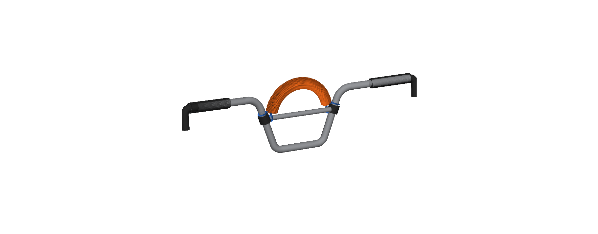
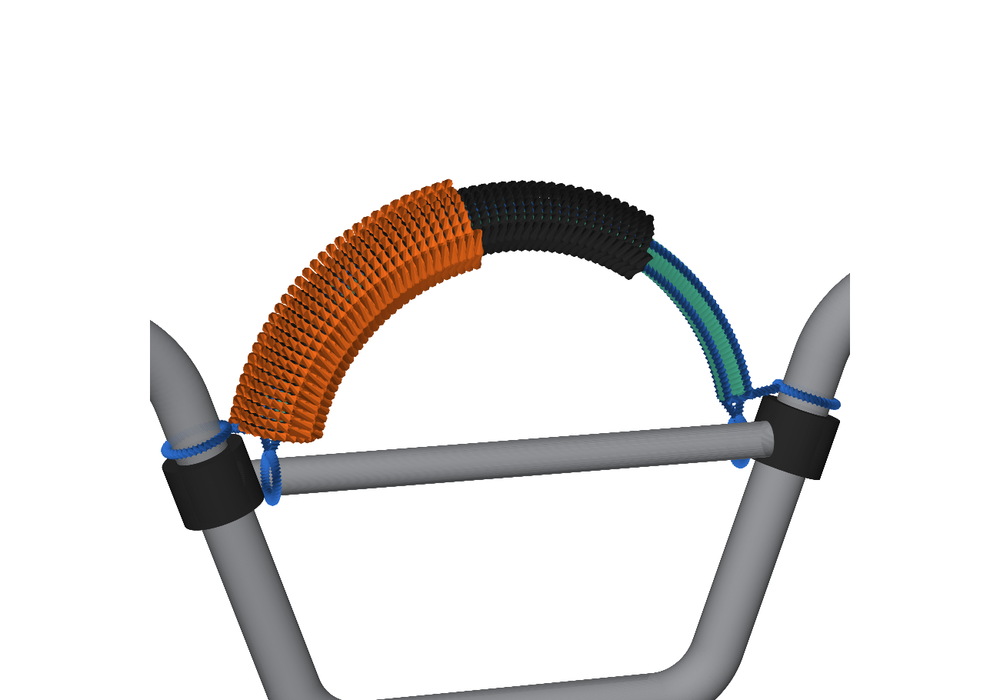
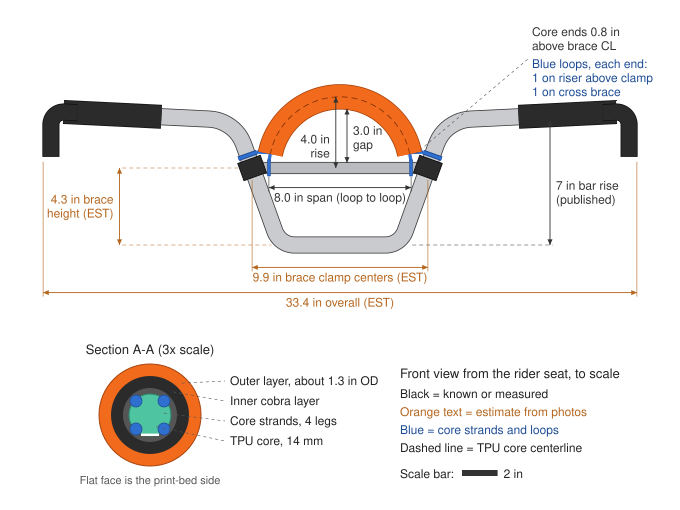
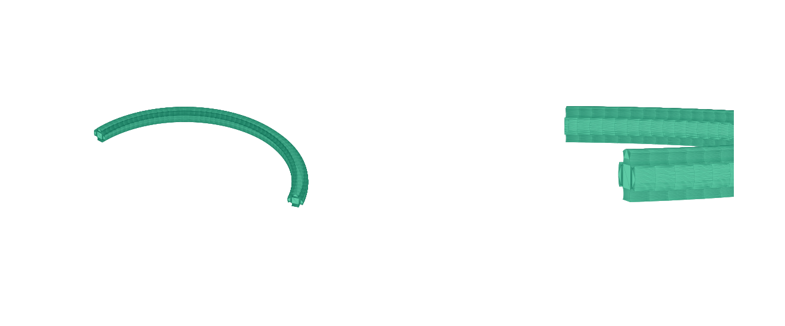
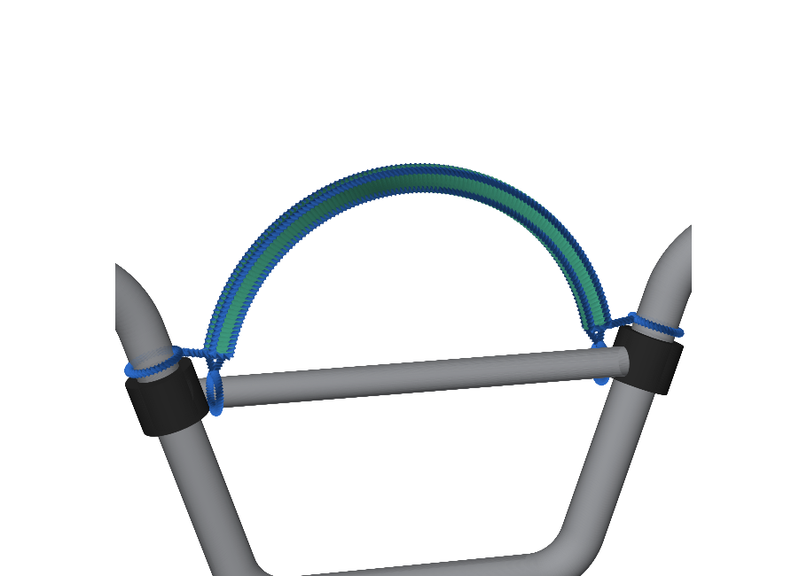
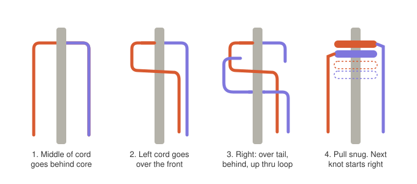
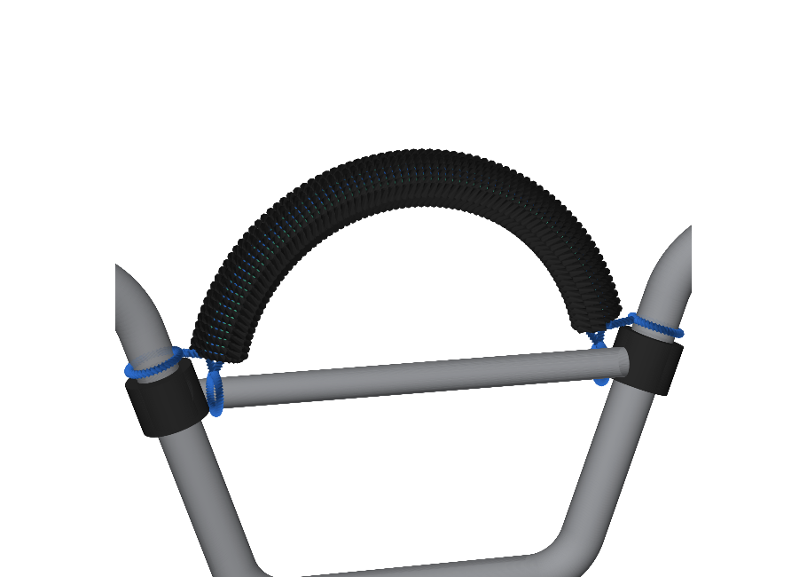
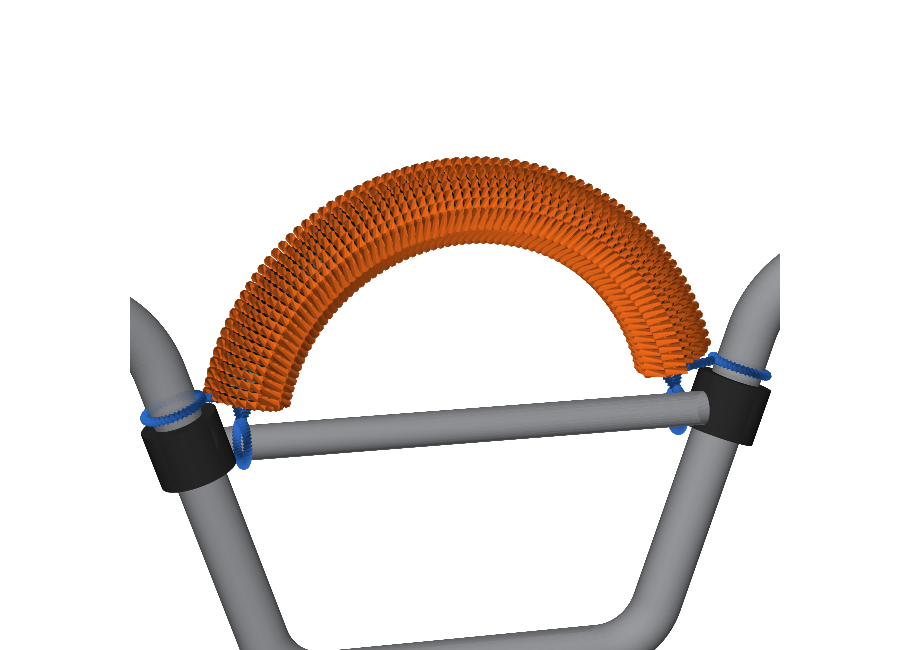
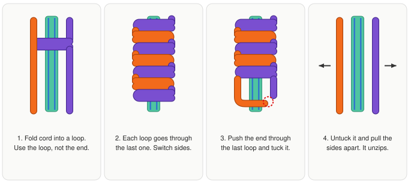

# Sled grab bar: paracord handle project

We are making a new grab handle for Dad's snowmobile, a 2017 Polaris RMK Pro 800.
The old rubber handle on the handlebar broke.
The new handle is a paracord braid over a 3D-printed core.



---

## How it works

The handle has three parts:

| Part | Color in the pictures | What it does |
|---|---|---|
| **Core strands** | Blue | Two cords that run the full length of the handle. They loop around the bar at each end. **This is the part that holds you.** |
| **TPU core** | Green | A bendy, 3D-printed arch. It keeps the handle standing up so you can grab it. It does **not** hold your weight. |
| **Braid** | Black and orange | The knots we tie on the outside. It locks everything together and gives you something to grip. |

This picture shows the build in stages. Right side: only the core and the strands. Top: the first braid layer (black). Left: the outer layer (orange).



### How the loops hold on

Each end of the handle has **two loops**:

- **Loop 1** goes around the **main bar**, just above the black clamp. The clamp stops it from sliding down.
- **Loop 2** goes around the **cross brace**. It takes the pull when you grab the handle.

With two loops, each end is held in two directions. The handle can't slide sideways or twist.

### Sizes (to scale)



- **Span:** 8 in from loop to loop
- **Height:** 4 in from the brace up to the middle of the arch
- **Hand gap:** about 3 in at the top. Check that a gloved hand fits.
- The outer braid is about 1.3 in thick.

---

## What you need

- **Paracord:** 100 ft of real "MIL-C-5040H Type III" 550 cord. Look for those words on the package. Two colors look great.
  - About 7 ft for the core strands
  - About 10–12 ft for the inner cobra layer
  - About 15–20 ft for the outer layer
  - The rest is spare
- **TPU core:** print `cad/tpu_arch_core.stl` (see Step 1)
- Scissors
- A lighter to melt the cord ends. **Only a grown-up uses the lighter.**
- Heat-shrink tube or tape, to protect the loops where they touch metal
- A clamp or a helper, to hold the core while you braid

---

## Step 1: Print the core

- Material: TPU 95A
- Flat side down on the bed. No supports.
- 4 walls, 30–40% gyroid infill
- Print slowly, about 20–30 mm/s.
- **Freeze test:** put it in the freezer overnight, then bend it hard. It should bend and spring back, not crack.



## Step 2: Add the core strands and the loops

The core has **4 grooves**: 2 on the rider side and 2 on the front side.

1. Cut two cords, each about 3.5 ft long.
2. **Cord 1** goes in the **2 rider-side grooves**. At each end, wrap it around the **main bar** just above the black clamp, then back into the other groove.
3. **Cord 2** goes in the **2 front-side grooves**. At each end, wrap it around the **cross brace**, then back into the other groove.
4. Join each cord's two ends where they meet along the core. The braid will cover the join.
5. Pull the cords tight so the core squeezes a little. That keeps the loops pushed out where they belong.
6. Put heat-shrink or tape on each loop where it touches metal.



## Step 3: Tie the inner layer (cobra knot)

Use one long cord. Find its middle. Follow the pictures:



1. Put the **middle** of the cord **behind** the core.
2. Take the **left** cord **over** the front. Leave a loop on the left.
3. Take the **right** cord **over** the tail, **behind** the core, and **up through** the loop.
4. **Pull both cords snug.** That is one knot.
5. Next knot: start on the **right** side. Do the same moves, mirrored.
6. **Keep switching sides.** If you forget to switch, the braid twists into a spiral.
7. Keep going until you reach the other end. Finish the ends (Step 5).

A short trick to remember it: **over, over, under, through.**



## Step 4: Tie the outer layer (pick one)

### Option A: King cobra (tidy, very tough)

Tie **another cobra knot over the first layer**, the same way as Step 3.
It makes the handle fat and easy to grab with gloves on.



### Option B: Quick-pull (spare rope you can get out fast)

This layer comes apart in seconds when you pull it, so Dad gets about 15–20 ft of rope in an emergency.
It is built from **loops of cord**, not cord ends. Each loop holds the next one, like a chain.



1. Fold the cord into a **loop**. Lay the loop **over** the front of the inner layer.
2. Make a loop with the other cord. Pass it **behind** the core and **through** the first loop. Pull the first cord to snug it.
3. Make the next loop from the first side. It goes **through** the last loop. **Keep switching sides.**
4. At the end, push the **cord end** (not a loop) through the last loop. Tuck it under the braid. This locks the whole layer.
5. **To use it:** untuck the end and pull the two sides apart. The layer unzips. The inner layer and the core strands stay in place, so the handle still holds.

**Important:** the quick-pull layer must be the **outer** layer. If it is under the king cobra, you would have to untie the king cobra first.

**Tip:** watch a short video of "quick deploy cobra" or "quick release Solomon bar" once. The loop moves are easier to see than to read.

## Step 5: Finish the ends

1. Cut the extra cord, leaving about 1/4 in.
2. **A grown-up** melts each end with the lighter.
3. Tuck the melted end under the last knot.
4. For the quick-pull lock, melt the end only a little, so it still pulls free.

## Step 6: Safety test (do not skip)

1. Pull up and back on the handle hard, like you are hanging off the side of the sled.
2. Check that nothing slips, stretches, or cracks.
3. Check that the loops stay put, both on the main bar and on the brace.
4. Check that the handlebar still turns all the way left and right.

---

## Notes for Dad

### Files

| Path | What it is |
|---|---|
| `cad/rmk_bar_2883837.step` | Handlebar assembly (Polaris 2883837 / bar 1824838), 12 bodies, for Onshape |
| `cad/rmk_bar.py` | CadQuery script for the bar. Sizes at the top. |
| `cad/tpu_arch_core.step` / `.stl` | TPU core for Onshape / for printing |
| `cad/tpu_core.py` | CadQuery script for the core |
| `tools/drawings.py` | Makes the dimensioned drawing and knot step drawings from the model numbers |
| `tools/render3d.py` | Makes the 3D renders from the bar STEP and the handle geometry |

### How accurate the models are

- **Known:** 7/8 in bar OD, 7 in rise, 8 in handle span, 4 in handle height.
- **Estimated from photos (orange on the drawing):** bar width, clamp area, bends, brace height (about 4.3 in), brace clamp centers (about 9.9 in), brace OD (about 15 mm).
- The bar estimate was re-proportioned so the brace clamps sit just outside an 8 in loop span. **Measure clamp-to-clamp on the brace and the brace OD before you print.**
- The core ends stop 0.8 in above the brace centerline to leave room for the loops.
- The renders show the braid as a simplified weave. Knot spacing and layer thickness are close to real 550 cord, but not exact.

### Load path

- At each end, the riser loop and the brace loop each have 2 legs, so 4 legs in total.
- The brace loop takes the up pull. The riser loop stops inward slide. The clamp stops the riser loop from sliding down.
- Real Type III cord has 7 or more inner strands and a 550 lb rating. Nylon loses about 15% of its strength when wet. That doesn't matter with 4 legs.
- The quick-pull layer carries no load. Pulling it out does not weaken the handle.

### To rebuild everything

```bash
pip install cadquery matplotlib
python3 cad/rmk_bar.py && mv rmk_bar_2883837.step cad/
python3 cad/tpu_core.py && mv tpu_arch_core.* cad/
python3 tools/drawings.py images
python3 tools/render3d.py images
```

### Possible next part

TPU saddles that clip on the bar and the brace in place of heat-shrink. Each would have a groove to hold its loop. To make them, I need the brace OD and the bare lengths beside each clamp.
